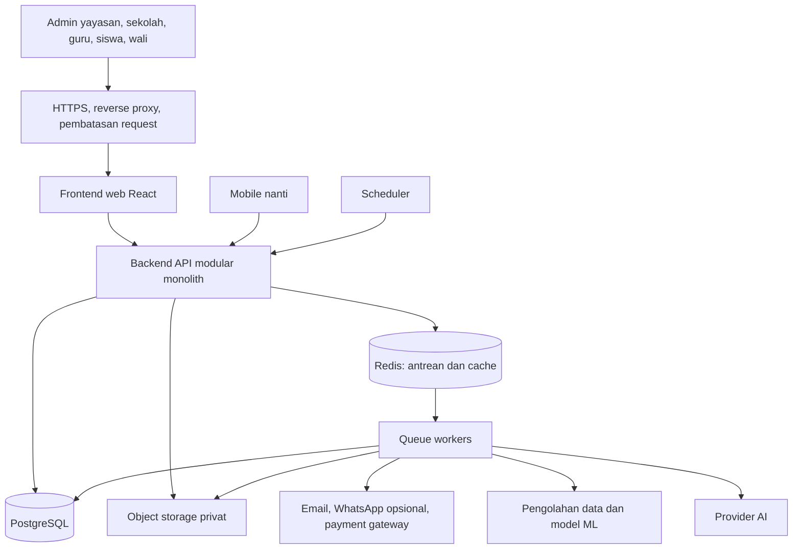

# Usulan arsitektur SaaS Sekolix

Tanggal: 1 November 2026. Status: rancangan diperbarui berdasarkan pembahasan; belum merupakan implementasi aplikasi baru.

## Keputusan dan asumsi

| Hal | Status | Arah rancangan |
| --- | --- | --- |
| Pelanggan yayasan/organisasi dengan banyak sekolah | Disetujui pengguna | Satu tenant dapat memiliki beberapa sekolah |
| Pendaftaran pelanggan per sekolah | Diminta pengguna | Sekolah mandiri mendapat tenant dengan satu sekolah |
| Isolasi tenant | Disetujui pengguna | Satu schema PostgreSQL per organisasi/yayasan; sekolah mandiri juga memiliki schema sendiri |
| Rewrite total | Diizinkan pengguna untuk implementasi nanti | Teknologi dan UI baru dapat dirancang tanpa harus mempertahankan implementasi sekarang |
| Backend | Disetujui pengguna | Django + Django REST Framework dan worker Python, satu ekosistem |
| Arah AI/ML | Disetujui pengguna | AI generatif serta analitik/pelatihan model sendiri, dikembangkan bertahap |
| Provider AI tahap awal | Disetujui pengguna | DeepSeek melalui API terkelola terlebih dahulu |
| Frontend dan backend | Disetujui pengguna | Frontend web terpisah dari backend API, satu repository |
| Schema utama platform | Usulan diperjelas | Billing SaaS, marketing, pengelolaan tenant, provisioning, dan catatan rollout migration |
| Domain sekolah | Disetujui pengguna | Custom domain untuk website/PPDB sekolah; portal login tetap pada domain aplikasi pusat |
| Pendekatan UI | Disetujui pengguna | UI khusus sekolah, memakai komponen siap pakai; pengalaman disesuaikan per peran |
| Library UI | Usulan | React + Mantine dengan tema dan alur khusus sekolah |
| Penyimpanan file | Disetujui pengguna | Cloudflare R2, bucket privat dan akses terotorisasi |
| Cakupan versi pertama | Menunggu jawaban | Usulan: administrasi, akademik, absensi, dan SPP |
| Tim, anggaran, dan target beban | Menunggu jawaban | Asumsi sementara: 1–3 developer, pilot 3–10 sekolah |
| Status produksi dan data yang harus dipertahankan | Menunggu jawaban | Menentukan strategi perpindahan dari proyek sekarang |

## Rekomendasi utama

Django + Django REST Framework dipilih sebagai backend API berbentuk modular monolith. Worker Python menjalankan pekerjaan data, AI, dan ML di proses terpisah dengan batas resource serta concurrency. Usulan frontend tetap React terpisah. Seluruh kode dapat berada dalam satu repository; penempatan API dan worker bisa dipisahkan saat beban mengharuskannya.

Web dan mobile memakai kontrak API Django yang sama. Pemilihan Python menyelaraskan bahasa dan tooling backend dengan pengolahan data/model. Keuntungan tersebut tidak otomatis menjamin runtime paling ringan atau hasil model yang baik; keduanya memerlukan pengukuran.

Usulan stack:

| Bagian | Pilihan utama | Alasan |
| --- | --- | --- |
| Backend | Django versi yang masih didukung + Django REST Framework | Backend sekolah dan pengolahan data memakai ekosistem Python |
| Antarmuka portal | React + TypeScript + Vite | Frontend terpisah yang mengakses API; hasil build web dapat dilayani sebagai aset statis |
| Tampilan | Mantine + CSS dan tema khusus sekolah | Dasar komponen siap pakai; navigasi dan alur dirancang untuk tugas pengguna sekolah |
| Database | PostgreSQL dengan schema per tenant | Pemisahan tabel organisasi, dengan privilege dan routing koneksi yang terkendali |
| ORM dan tenancy | Django ORM/migration + kandidat django-tenants | Mendukung pemisahan shared apps dan tenant apps; versi serta privilege perlu diverifikasi |
| Antrean | Usulan: Celery + Redis | Impor, ekspor, PDF, notifikasi, dan pekerjaan data/AI berjalan di worker |
| Penyimpanan dokumen | Cloudflare R2 melalui adapter S3 Python | Dipilih pengguna; dokumen disimpan terpisah dari disk aplikasi |
| Login web | Django session cookie aman + CSRF + MFA untuk admin | Frontend dapat diproksikan dari origin yang sama dengan API |
| API | REST JSON `/api/v1` + OpenAPI | Kontrak untuk web, mobile, dan integrasi yang diotorisasi |
| Mobile nanti | Kandidat: React Native + Expo | Memanfaatkan TypeScript dan API yang sama; UI native tetap perlu dibuat tersendiri |
| Data dan ML | Usulan awal: SQL, pandas, dan scikit-learn | Statistik serta model tabular sesuai kebutuhan dan kesiapan data |

Backend Django + DRF dan worker Python sudah dipilih. Celery, library ML, serta versi paket merupakan usulan implementasi. Django admin dapat dipakai sebagai alat internal terbatas; portal civitas sekolah dan wali tetap UI khusus yang sudah dipilih pengguna.

Pilih kombinasi Django, Python, DRF, dan paket tenancy yang masih didukung dan terbukti kompatibel. Versi terbaru tidak langsung ditetapkan tanpa pemeriksaan dependency. Referensi: [dukungan versi Django](https://www.djangoproject.com/download/), [DRF](https://www.django-rest-framework.org/), [django-tenants](https://django-tenants.readthedocs.io/en/latest/).

Vite menghasilkan build yang dapat dilayani sebagai file statis. Server Node.js yang selalu berjalan tidak diperlukan untuk frontend SPA biasa. Mantine menyediakan pengaturan tema untuk komponen. Referensi: [deploy Vite](https://vite.dev/guide/static-deploy.html), [tema Mantine](https://mantine.dev/theming/theme-object/).

Celery menjalankan tugas melalui broker dan worker terpisah. Pisahkan antrean operasional penting dari pekerjaan laporan dan data/ML; batasi CPU, memori, serta concurrency untuk mencegah pekerjaan berat menghabiskan resource API. Referensi: [Celery](https://docs.celeryq.dev/en/stable/getting-started/introduction.html).

### Evaluasi backend alternatif

Perbandingan berikut merupakan penilaian untuk kebutuhan Sekolix, bukan hasil benchmark aplikasi. Pengguna sudah memilih Django + DRF dan worker Python karena menargetkan AI generatif serta ML sendiri secara bertahap. Efisiensi runtime, kelengkapan komponen bisnis, kecepatan implementasi, dan kemampuan tim merawat aplikasi adalah kriteria yang berbeda.

| Pilihan | Kekuatan untuk Sekolix | Pekerjaan atau batas yang perlu dipertimbangkan | Posisi rekomendasi |
| --- | --- | --- | --- |
| Laravel | Komponen autentikasi, otorisasi, ORM/migration, queue, scheduler, dan notifikasi tersedia dalam ekosistem yang menyatu | Integrasi worker Python menambah batas antarsistem jika model sendiri dibangun dalam Python | Alternatif untuk tim yang lebih nyaman dengan PHP |
| Go | Program dikompilasi menjadi executable; goroutine dan library HTTP cocok untuk API konkuren | Komponen SaaS perlu diintegrasikan; pipeline ML Python menjadi lapisan dengan bahasa berbeda | Alternatif jika efisiensi runtime lebih diprioritaskan |
| Python + Django + DRF | ORM, migration, autentikasi, admin internal, dan ekosistem pengolahan data Python; tersedia django-tenants | Custom UI tetap diperlukan; resource API dan worker berat perlu dibatasi | Dipilih pengguna untuk aplikasi sekolah dengan AI/ML bertahap |
| Python + FastAPI | API bertipe dengan OpenAPI dan dependency injection | Komponen SaaS lengkap perlu dirakit dari beberapa paket; fitur async tidak otomatis mempercepat komputasi CPU | Cocok bila tim ingin API Python dengan komposisi komponen sendiri |
| Rust + Axum | Kontrol alokasi/memori, type system, dan dukungan middleware melalui ekosistem Tower | Kecepatan pengembangan serta biaya perawatan perlu dinilai dari pengalaman tim; fitur sekolah lengkap tetap harus dibangun | Pilih jika tim menguasai Rust atau ada kebutuhan performa yang terbukti |

Referensi primer: [Go compile/install](https://go.dev/doc/tutorial/compile-install), [goroutine Go](https://go.dev/doc/faq#goroutines), [Django](https://docs.djangoproject.com/en/5.2/intro/overview/), [django-tenants](https://django-tenants.readthedocs.io/en/latest/), [FastAPI](https://fastapi.tiangolo.com/features/), [Rust](https://rust-lang.org/), [Axum](https://docs.rs/axum/latest/axum/).

django-tenants menyediakan dukungan pola schema, tetapi paket tenancy tidak otomatis membuktikan isolasi privilege atau kompatibilitas versi yang akan dipakai. Evaluasi tersebut berlaku pada semua bahasa dan paket.

Pada kandidat django-tenants, `PUBLIC_SCHEMA_NAME` dapat menentukan nama schema bersama sehingga katalog dapat memakai nama `platform`. Pisahkan `SHARED_APPS` dan `TENANT_APPS`, serta konfigurasi provisioning agar pembuatan schema/migration ditangani job terkontrol. Context manager tenant/schema dapat membantu pemulihan search path pada worker; pengujian privilege, pooling, dan identitas global tetap diperlukan. Referensi: [konfigurasi django-tenants](https://django-tenants.readthedocs.io/en/latest/install.html), [konteks dan background provisioning](https://django-tenants.readthedocs.io/en/latest/use.html).

Untuk Laravel, mulai dari deployment yang sederhana. Octane dapat dievaluasi bila profiling menunjukkan manfaat; worker berumur panjang mengharuskan pengujian bahwa request, konfigurasi, atau konteks tenant sebelumnya tidak tersimpan pada singleton/global. Risiko state yang tertinggal juga harus ditangani pada server Go, Rust, Python, serta queue worker. Referensi: [state pada Laravel Octane](https://laravel.com/docs/13.x/octane).

Sebelum memilih backend berdasarkan performa, gunakan alur representatif: daftar siswa dengan pencarian/paginasi dan otorisasi, pencatatan absensi serentak, serta pembuatan/alokasi pembayaran SPP. Ukur p95 latency, CPU, RAM, koneksi database, dan waktu implementasi pada data serta batas resource yang sebanding. Rencana ini belum dijalankan dan tidak merupakan klaim kapasitas.

Billing, akademik, dan tenant management tetap menjadi modul dalam backend Django yang sama. Worker Python dapat memakai kode domain yang sama dan dijalankan sebagai proses terpisah. FastAPI dapat ditambahkan nanti jika inferensi model perlu layanan mandiri; tahap awal tidak membutuhkan Django dan FastAPI sekaligus.

### Pengolahan data, AI generatif, dan ML

Pengguna memilih keduanya dikembangkan bertahap. Pisahkan jenis kebutuhan agar urutan investasi jelas:

| Kebutuhan | Pendekatan awal |
| --- | --- |
| Rekap, tren absensi, dan analisis tagihan | SQL dan statistik yang dapat diverifikasi; pandas untuk pengolahan batch bila diperlukan |
| Asisten dokumen, pencarian, dan rangkuman | Integrasi provider AI melalui backend; retrieval mengikuti tenant, sekolah, serta permission dokumen |
| Model prediksi sendiri | Dataset snapshot, preprocessing, baseline, pelatihan, evaluasi, dan versi model; kandidat awal scikit-learn untuk data tabular |
| Deep learning atau model khusus yang berat | Evaluasi PyTorch, model yang sesuai, dan kebutuhan CPU/GPU setelah use case terbukti |

Referensi ekosistem: [pandas](https://pandas.pydata.org/docs/getting_started/overview.html), [scikit-learn](https://scikit-learn.org/stable/common_pitfalls.html), [PyTorch](https://pytorch.org/get-started/locally/). Laravel dan Go tetap bisa mengintegrasikan layanan AI melalui API; kebutuhan AI generatif saja tidak mengharuskan backend Python. Sebagai contoh, [Laravel AI SDK](https://laravel.com/docs/13.x/ai-sdk) menyediakan integrasi provider, rangkuman, dan embeddings. Pemilihan Python di sini mengikuti target pengolahan data dan model sendiri sekaligus.

Alur sinkronisasi yang disarankan:

```text
Transaksi operasional di schema tenant
  -> outbox/event setelah perubahan tersimpan
  -> pekerjaan batch/snapshot dengan scope tenant yang sah
  -> worker pengolahan data, AI, atau ML
  -> simpan hasil beserta versi data/model dan waktu pembaruan
  -> backend memvalidasi scope/status lalu menyajikan hasil ke web/mobile
```

PostgreSQL tetap sumber data operasional utama. Dataset snapshot dan artefak model dapat disimpan privat di R2, dengan versi, tenant owner, retensi, dan metadata yang tercatat. Hindari menjalankan training atau pemindaian data besar pada request HTTP pengguna; jadwalkan ekstraksi yang terukur dan gunakan replika/penyimpanan analitik hanya jika beban mengharuskannya.

Payload job memakai ID tenant, school scope bila relevan, referensi sumber, event/job ID, dan versi data. Worker mengambil schema dari registry terpercaya serta menginisialisasi dan membersihkan konteks tenant pada setiap tugas. Retry dan penyimpanan hasil bersifat idempoten. Hasil untuk versi data lama tidak boleh menimpa hasil terbaru tanpa aturan yang disengaja.

Metadata global kemampuan AI dan versi model umum dapat berada di `platform`. Dokumen, embedding/index tenant, dataset milik tenant, hasil prediksi, percakapan, dan audit pengguna mengikuti kepemilikan tenant. Model yang dilatih dari data satu organisasi tetap mengikuti batas data organisasi tersebut. Penggunaan data lintas organisasi memerlukan keputusan dan otorisasi tersendiri.

Hak akses diterapkan saat memilih sumber, membuat dataset, retrieval dokumen, menjalankan tool AI, serta menampilkan hasil. Permintaan AI menggunakan permission pengguna atau service identity yang terbatas. Kirim data minimum yang dibutuhkan ke provider; tentukan penyimpanan percakapan, retensi, biaya, dan batas penggunaan per paket sebelum fitur diaktifkan.

Untuk model sendiri, tetapkan pertanyaan bisnis dan ukuran keberhasilan lebih dahulu. Sediakan label yang layak, bandingkan dengan aturan/statistik sederhana, pisahkan data train/test sebelum preprocessing, dan gunakan pembagian waktu atau kelompok siswa sesuai pertanyaan evaluasi. Simpan versi dataset, fitur, model, metrik, dan hasil validasi. Periksa kebocoran informasi masa depan agar skor tidak memberi gambaran yang terlalu optimistis. Referensi prinsip evaluasi: [scikit-learn tentang data leakage](https://scikit-learn.org/stable/common_pitfalls.html#data-leakage).

Sajikan hasil model sebagai informasi untuk ditinjau petugas yang berwenang, lengkap dengan waktu pembaruan dan batas pemakaiannya. Pantau kualitas, biaya, serta perubahan pola data setelah rilis. AI yang gagal atau timeout tidak boleh menggagalkan fungsi inti seperti absensi dan pembayaran.

Tahapan yang disarankan: (1) rapikan event, kualitas data, audit dan statistik dasar; (2) hadirkan satu fitur AI generatif yang terukur serta terotorisasi; (3) bangun satu baseline model dengan dataset/evaluasi yang memadai; (4) perluas serving dan pelatihan sesuai hasil penggunaan.

### DeepSeek melalui API pada tahap awal

Pengguna memilih DeepSeek API terkelola. Backend mengelola kredensial, otorisasi, pemilihan model, batas penggunaan, dan pencatatan pemakaian. Pemanggilan provider tidak dilakukan langsung dari browser dengan API key platform.

Model dengan bobot terbuka dan layanan API terkelola merupakan dua cara penggunaan yang berbeda. Untuk pilihan API, pemakaian tetap ditagih sesuai token dan ketentuan provider; tahap awal tidak membutuhkan operasi server model mandiri. Referensi: [API DeepSeek](https://api-docs.deepseek.com/), [tarif DeepSeek](https://api-docs.deepseek.com/quick_start/pricing/).

Gunakan adapter provider internal agar frontend memanggil kemampuan Sekolix, misalnya rangkuman atau tanya dokumen, tanpa bergantung langsung pada endpoint dan nama model provider. Pilih ID model yang tersedia setelah uji kualitas Bahasa Indonesia, format keluaran, latency, dan biaya. Simpan model/version yang dilaporkan provider beserta konfigurasi relevan untuk evaluasi.

Konfigurasi tingkat platform mencakup referensi secret, model yang diizinkan, batas token/request, timeout, dan budget. Catat ledger pemakaian per tenant, fitur, dan pengguna, dengan token/biaya yang dilaporkan provider bila tersedia; tangani request serentak agar kuota tidak terlampaui akibat pemeriksaan yang terpisah dari reservasi pemakaian. Pisahkan log penggunaan dari isi percakapan dan dokumen sensitif.

Sebelum permintaan dikirim, backend memverifikasi akses pengguna, memilih sumber yang sah, dan membatasi data yang dibagikan. Kebijakan data/retensi provider dan data sekolah yang diizinkan keluar perlu dievaluasi sesuai fitur; memakai model berbobot terbuka melalui API tetap mengirim data ke penyedia layanan tersebut. Retry, rate limit, timeout, dan kegagalan provider tidak boleh menghambat absensi atau pembayaran.

Pemakaian DeepSeek API untuk AI generatif tidak mengubah rencana worker Python dan model ML tabular sendiri. Dataset/model prediksi milik tenant tetap mengikuti pemilik, versi, dan otorisasi yang telah ditentukan.

### Pilihan frontend

| Pilihan | Cocok ketika | Konsekuensi |
| --- | --- | --- |
| React + TypeScript + Vite, dengan usulan Mantine | Tim memakai React dan ingin komponen siap pakai dengan UI khusus | Selaraskan kontrak API dan kebutuhan aksesibilitas dengan komponen yang dipilih |
| Vue + TypeScript + Vite, dengan kandidat PrimeVue | Tim lebih nyaman dengan Vue | UI dan kontrak API tetap perlu dirancang serta diuji |
| UI web dengan Bootstrap dan komponen khusus | Tim menginginkan dasar visual yang konvensional | Interaksi serta komponen domain tetap perlu dikembangkan |

Pengguna mengizinkan rewrite total pada tahap implementasi nanti dan memilih frontend web terpisah dari Django API dalam satu repository. React + Mantine masih merupakan usulan. Pemeriksaan awal repositori belum merupakan audit kualitas atau kesiapan produksi.

### UI untuk pengguna sekolah

Pengguna memilih UI khusus sekolah di atas komponen siap pakai. Usulan library adalah Mantine; keputusan ini belum dikunci. Alternatif yang tetap layak adalah Vue + PrimeVue atau Bootstrap dengan komponen khusus, sesuai kemampuan tim.

Kesederhanaan dinilai dari keberhasilan pengguna menyelesaikan tugas. Mengganti library perlu disertai penyederhanaan menu, istilah, formulir, dan jumlah langkah.

| Pengguna | Fokus beranda dan navigasi |
| --- | --- |
| Admin sekolah/TU | Siswa, kelas, kehadiran, tagihan, dan pekerjaan yang menunggu tindakan; menu mengikuti permission |
| Pengelola yayasan | Ringkasan beberapa sekolah dan pemilih sekolah; detail sesuai kewenangan |
| Guru | Jadwal hari ini, isi absensi, tugas, dan nilai kelas yang diajar |
| Siswa | Jadwal, tugas, pengumuman, dan hasil belajar |
| Wali | Pemilih anak, kehadiran, tagihan, dan pengumuman; tampilan ringkas untuk layar ponsel |

Usulan pola: 4–6 tujuan utama per peran, label Bahasa Indonesia, satu aksi utama yang jelas per halaman, formulir bertahap saat panjang, dan informasi lanjutan ditampilkan sesuai kebutuhan. Angka menu merupakan titik awal pengujian, bukan batas kaku.

UI harus mendukung keyboard, fokus yang terlihat, teks yang terbaca, target sentuh yang nyaman, kondisi loading/kosong/error, dan koneksi lambat. Uji prototipe dengan operator sekolah, guru, serta wali sebelum menerapkan pola ke seluruh modul.

### Pemisahan frontend, backend, dan mobile

Usulan susunan repository:

```text
apps/api/             Django + DRF dan modul domain
apps/web/             React + TypeScript + Vite
apps/workers/         entry point worker Python dan pekerjaan data/ML
apps/mobile/          ditambahkan ketika mobile mulai dikerjakan
packages/api-client/  tipe dan klien yang dihasilkan dari OpenAPI
packages/python/      modul Python bersama bila dibutuhkan
```

Pada awal operasi, reverse proxy dapat melayani hasil build web dan meneruskan `/api/v1` serta endpoint autentikasi ke Django pada origin yang sama. Domain/server terpisah dapat dipakai kemudian. Jika memakai subdomain terpisah, konfigurasi cookie, trusted origin, CSRF, dan CORS harus diuji bersama.

Web first-party memakai session cookie dan CSRF, termasuk perlindungan CSRF pada endpoint login. Mobile memerlukan mekanisme token dengan expiry, penyimpanan aman perangkat, serta rotasi/pencabutan yang dirancang dan diuji. Paket autentikasi mobile/OAuth belum dipilih; jangan mengasumsikan token sederhana DRF sudah memenuhi seluruh kebutuhan tersebut. Referensi: [autentikasi DRF](https://www.django-rest-framework.org/api-guide/authentication/), [Expo SecureStore](https://docs.expo.dev/versions/latest/sdk/securestore/).

Aturan bisnis dan otorisasi tetap berada pada backend. Kontrak API mencakup paginasi, bentuk error, filter, upload, idempotensi transaksi penting, dan kompatibilitas versi. Mobile dapat tertinggal versi dari web sehingga perubahan API harus menjaga klien yang masih didukung.

React web dan React Native dapat berbagi tipe/klien API serta sebagian logika non-UI. Komponen Mantine untuk web tidak otomatis menjadi komponen native. Kebutuhan offline, push notification, dan sinkronisasi harus dirancang tersendiri; aplikasi mobile pertama dapat dimulai dengan kebutuhan online.

## Gambaran sistem



Worker menggunakan kode aplikasi yang sama. Pisahkan antrean pembayaran/notifikasi, impor, dan laporan supaya ekspor besar tidak menghambat pekerjaan penting. Antrean harus dapat dipulihkan; jangan menempatkan antrean penting pada konfigurasi cache yang dapat membuang kunci saat memori penuh.

## Pelanggan, sekolah, dan pendaftaran

Tenant adalah ruang data milik pelanggan. Nama tabel yang disarankan adalah `organizations`; atribut `type` membedakan `SCHOOL` dan `FOUNDATION`.

```text
Sekolah mandiri mendaftar
  -> organization type=SCHOOL
  -> satu school
  -> pemilik dan membership awal
  -> trial atau paket berlangganan

Yayasan mendaftar
  -> organization type=FOUNDATION
  -> sekolah pertama
  -> undang pengelola dan tambah sekolah berikutnya
```

Pendaftaran yayasan tidak mensyaratkan banyak sekolah langsung tersedia. Satu akun juga dapat menjadi anggota beberapa organisasi, tetapi harus memilih konteks organisasi dan sekolah saat bekerja.

PPDB/SPMB siswa merupakan alur terpisah dari pendaftaran pelanggan SaaS. Setiap sekolah mempunyai periode, formulir, kuota, pilihan program, biaya, dan pengaturan publik sendiri.

Keputusan pengguna: website dan PPDB sekolah mendukung custom domain, sedangkan portal login memakai domain aplikasi pusat dengan pemilih sekolah/anak sesuai membership. Subdomain bawaan Sekolix tetap dapat disediakan sebagai alamat awal atau alternatif.

### Integrasi domain sekolah

Contoh alamat berikut merupakan placeholder:

| Alamat | Kegunaan |
| --- | --- |
| `app.sekolix.example` | Portal login admin, guru, siswa, dan wali |
| `sekolah-a.sekolix.example` | Alamat bawaan website sekolah |
| `www.sekolah-a.example` | Custom domain website sekolah di Sekolix |
| `ppdb.sekolah-a.example` | Custom subdomain PPDB bila dipisahkan |

Sekolah tetap memiliki dan memperpanjang domainnya melalui penyedia domain masing-masing. Menghubungkan hostname tidak memerlukan aplikasi atau database baru per domain. Jika website lama dipertahankan, PPDB dapat memakai subdomain tersendiri, sedangkan website lama menautkan portal Sekolix.

Registry `platform.domains` menyimpan hostname unik yang dinormalisasi, tenant ID, school ID bila relevan, fungsi hostname, status verifikasi kepemilikan, status DNS/TLS, serta referensi konfigurasi penyedia edge. Satu yayasan dapat memiliki beberapa domain yang mengarah ke sekolah berbeda dalam schema yang sama; pemetaan school ID harus diverifikasi terhadap tenant pemiliknya.

Alur aktivasi yang disarankan:

```text
Admin sekolah menambahkan hostname
  -> verifikasi hak admin dan keunikan hostname
  -> tampilkan record pembuktian kepemilikan dan target DNS
  -> sekolah memasang TXT/CNAME sesuai penyedia
  -> verifikasi kepemilikan, routing DNS, dan sertifikat HTTPS
  -> aktifkan pemetaan hostname ke tenant dan sekolah
```

Cloudflare for SaaS merupakan kandidat untuk custom hostnames dan validasi/TLS terkelola; pemilihan penyedia edge belum dikunci. Referensi: [Cloudflare for SaaS](https://developers.cloudflare.com/cloudflare-for-platforms/cloudflare-for-saas/), [validasi hostname](https://developers.cloudflare.com/cloudflare-for-platforms/cloudflare-for-saas/domain-support/hostname-validation/).

Instruksi DNS mengikuti hostname dan fitur penyedia. Subdomain seperti `www` atau `ppdb` umumnya memakai CNAME; domain apex memerlukan metode yang didukung penyedia DNS/edge, seperti flattening/ALIAS atau fitur apex khusus. Record email seperti MX tidak perlu diubah hanya untuk menghubungkan hostname website. Biaya pembelian/perpanjangan domain dan layanan edge merupakan komponen terpisah dari R2.

Gateway hanya menerima hostname yang sudah terverifikasi dan aktif. Hostname tidak dikenal ditolak; jangan mengarahkannya otomatis ke tenant default. Perubahan serta pelepasan domain memerlukan pemeriksaan kewenangan, pembaruan registry/cache, dan deprovisioning untuk mencegah hostname tetap terikat secara keliru.

Website dan PPDB custom domain hanya menyajikan sumber daya publik atau alur pendaftaran yang memang diotorisasi. Tombol masuk mengarahkan pengguna ke portal pusat dengan referensi sekolah yang diverifikasi backend. Session login tetap berada pada domain portal; jangan mengandalkan cookie yang dibagikan ke domain sekolah yang berbeda. SSO atau portal pada custom domain dapat dirancang sebagai tahap terpisah jika nanti dibutuhkan. Referensi cakupan cookie Django: [SESSION_COOKIE_DOMAIN](https://docs.djangoproject.com/en/5.2/ref/settings/#session-cookie-domain).

Pastikan metadata, canonical URL, tautan PPDB, dan branding sekolah memakai hostname aktif yang benar. Strategi render dan cache website publik harus mempertimbangkan SEO serta pembaruan konten per sekolah.

Jika sekolah yang telah mendaftar mandiri ingin bergabung ke yayasan, gunakan proses penggabungan yang ditinjau dan disetujui pihak berwenang. Penggabungan dapat mengubah kepemilikan data dan subscription; jangan menggabungkan data otomatis hanya karena nama, email, atau NPSN cocok.

## Model multitenancy database

Keputusan pengguna: satu database PostgreSQL dengan satu schema per organisasi/yayasan. Sekolah mandiri memiliki schema tenant sendiri. Beberapa sekolah dalam satu yayasan berada pada schema yayasan yang sama dan tetap menggunakan `school_id` serta otorisasi per sekolah.

```text
database sekolix
  platform
    users, organizations, organization_memberships
    tenant_registry, subscriptions, saas_invoices
  t_a12...                 organisasi sekolah mandiri A
    schools, students, enrollments, student_invoices, ...
  t_b34...                 organisasi yayasan B
    schools, students, enrollments, student_invoices, ...
```

Nama schema berasal dari ID internal dan registry terpercaya, bukan nama pelanggan atau input bebas. Schema `platform` menyimpan identitas serta metadata SaaS. Tabel bisnis dan akses per sekolah berada di schema tenant. Pisahkan migration platform dari migration tenant.

### Schema utama platform dan schema operasional tenant

Schema utama `platform` disarankan sebagai katalog bersama untuk pengelolaan SaaS. Pemisahan tanggung jawab ini sering disebut control plane dan data plane. Keduanya dapat berada dalam satu backend dan satu database pada tahap awal. Referensi konsep: [panduan control plane multitenant Microsoft](https://learn.microsoft.com/en-us/azure/architecture/guide/multitenant/considerations/control-planes).

| Data/fungsi | Tempat yang disarankan | Batas tanggung jawab |
| --- | --- | --- |
| Marketing Sekolix | `platform` | Landing produk, harga paket, artikel produk, dan template bersama |
| Identitas pelanggan | `platform` | Akun login, organisasi, membership organisasi, undangan, serta verifikasi domain |
| Katalog tenant | `platform` | ID tenant, schema/database penempatan, lifecycle, versi schema, dan status provisioning |
| Billing Sekolix | `platform` | Plan dan versi harga, subscription, entitlement, invoice serta pembayaran SaaS |
| Kendali rollout migration | `platform` | Rilis target, tenant sasaran, attempt, status, error yang aman, dan waktu pelaksanaan |
| Operasional platform | `platform` | Audit admin platform, pemberian akses support terbatas, dan konfigurasi tingkat platform |
| Website sekolah | Schema tenant | Identitas, halaman, berita, galeri, dan pengaturan publik sekolah terkait |
| PPDB/SPMB | Schema tenant | Periode, formulir, pendaftar, seleksi, dan pembayaran penerimaan sekolah |
| Operasional sekolah | Schema tenant | Siswa, staf, wali, enrollment, akademik, kehadiran, dan SPP |

Landing produk Sekolix dan website sekolah memiliki pemilik data berbeda. Registry domain dapat berada di platform untuk routing, sedangkan isi website sekolah tetap berada di tenant. Template bersama dapat diberi versi; perubahan template tidak boleh menimpa konten sekolah tanpa proses yang jelas.

Billing platform hanya menyimpan kewajiban pembayaran layanan Sekolix. Uang SPP dan tagihan siswa tetap menjadi data tenant. Harga invoice dan entitlement perlu memiliki versi/snapshot agar perubahan paket tidak mengubah transaksi lama.

Catatan registry tenant minimal mencakup ID, schema name, database/placement key, lifecycle status, current schema version, target schema version, dan referensi provisioning/migration terakhir. Kredensial disimpan pada pengelolaan secret dengan akses terbatas, bukan ditampilkan pada UI registry.

User sekolah, admin tenant, dan admin platform adalah kewenangan berbeda. Admin platform tidak otomatis memakai akses tanpa batas ke data siswa. Proses support yang membutuhkan data tenant menggunakan pemberian akses terbatas, memiliki masa berlaku, dan dicatat. API bisnis tidak memakai kredensial pemilik schema atau kredensial migration.

### Provisioning dan migration tenant

Alur pendaftaran yang disarankan:

```text
Daftar sekolah/yayasan
  -> catat organisasi dan tenant berstatus provisioning
  -> antrekan provisioning job dengan ID idempoten
  -> siapkan schema dan privilege
  -> jalankan migration versi terbaru yang telah diuji
  -> seed konfigurasi dasar dan buat sekolah awal
  -> tandai active setelah seluruh langkah berhasil
```

Job yang terputus dapat dilanjutkan atau dicoba ulang berdasarkan status langkah. Tenant yang belum siap tidak diarahkan ke schema yang setengah terbentuk.

UI management platform menjalankan rollout rilis migration yang berasal dari kode sumber dan sudah diuji. Definisi migration tetap berada dalam repository; schema platform menyimpan status pelaksanaannya. Proses provisioning/migration berjalan melalui worker dengan kredensial khusus, terpisah dari request pengguna biasa.

Untuk perubahan pada tenant yang sudah aktif: uji pada staging, mulai dari tenant percobaan, lalu jalankan batch dengan concurrency terbatas. Gunakan lock per tenant, timeout, pencatatan versi, dan retry yang aman. Kegagalan satu tenant tidak boleh menandai seluruh tenant sebagai berhasil. Dashboard menampilkan siapa yang berhasil, tertunda, atau gagal dan menyediakan retry terkontrol.

Gunakan perubahan bertahap yang kompatibel: tambahkan struktur baru, deploy kode yang bisa membaca versi lama/baru, backfill, pindahkan pemakaian, lalu hapus struktur lama pada rilis berikutnya. Jangan mengandalkan rollback migration yang dapat menghapus data untuk memulihkan deployment. Pemulihan aplikasi dan perbaikan schema harus direncanakan bersama.

Aktivitas normal siswa/guru tidak menjalankan DDL atau memicu migration dari HTTP request. Pembacaan status tenant dan entitlement dapat memakai cache dengan invalidasi/batas kedaluwarsa yang jelas; request sekolah tidak perlu memanggil penyedia pembayaran pada setiap akses.

### Tradeoff dan aturan isolasi

| Model | Kelebihan | Pertimbangan |
| --- | --- | --- |
| Database dan skema bersama | Operasional serta migration lebih sederhana, biaya awal lebih rendah | Memerlukan isolasi tenant yang ketat; pemulihan satu tenant membutuhkan prosedur khusus |
| Skema per tenant — dipilih | Tabel organisasi terpisah; export logis dapat dibatasi per schema | Privilege, migration seluruh tenant, katalog database, dan routing koneksi memerlukan pengelolaan khusus |
| Database per tenant | Pemulihan dan konfigurasi per pelanggan lebih mandiri | Provisioning, routing koneksi, pemantauan, dan migration seluruh database lebih mahal |

Schema menyediakan pemisahan namespace; pengguna database tetap dapat mengakses schema lain bila diberi privilege. Schema juga berbagi compute, storage, dan domain kegagalan database yang sama. Referensi: [schema PostgreSQL](https://www.postgresql.org/docs/current/ddl-schemas.html).

Sediakan metadata penempatan tenant agar database khusus dapat ditambahkan jika kebutuhan pelanggan mengharuskannya. Database terpisah pada server yang sama juga masih berbagi sumber daya server. Referensi tradeoff umum: [panduan multitenancy Microsoft](https://learn.microsoft.com/en-us/azure/architecture/guide/multitenant/service/sql-database).

Aturan isolasi yang perlu dibangun:

1. Konteks tenant diperoleh dari membership pengguna yang terautentikasi; parameter request saja tidak cukup.
2. Query aplikasi, route binding, ekspor, job, cache key, dan file key harus membawa konteks tenant. Sumber daya sekolah juga membawa konteks sekolah.
3. Gunakan role runtime dengan privilege terbatas pada schema tenant terkait; pisahkan akses metadata/identitas platform dari koneksi data tenant. Role migration dan provisioning memiliki kredensial berbeda dari runtime.
4. `search_path` saja tidak membatasi izin. Jangan memberi role runtime akses menyeluruh ke semua schema lalu menganggap isolasi sudah selesai. Batasi juga privilege `CREATE` dan akses schema bawaan sesuai kebutuhan.
5. Pilih konteks schema/role dari registry setelah membership diverifikasi. Konteks harus dibatasi pada transaksi atau koneksi yang siklus hidupnya terkendali, lalu dibersihkan saat selesai; berlaku juga untuk worker lama dan connection pool.
6. RLS dapat ditambahkan untuk batas sekolah bila kebutuhan dan pengujiannya jelas. Role runtime bukan superuser, pemilik tabel, atau pemilik `BYPASSRLS` bila RLS dipakai. Policy sekolah/kelas/wali tetap diperlukan pada aplikasi.
7. Foreign key dalam schema harus mengikat relasi ke sekolah/enrollment yang benar. Unique constraint seperti `(school_id, student_number)` berlaku di dalam tenant. Identitas sensitif tidak otomatis menjadi kunci unik global.
8. Kolom `tenant_id` tidak wajib diulang pada setiap tabel bisnis jika schema menentukan pemiliknya. Identitas tenant tetap wajib pada registry, job, audit lintas tenant, cache key, dan file key. `school_id` tetap diperlukan pada sumber daya sekolah.
9. Uji akses silang dengan query eksplisit ke schema lain, koneksi berulang, worker, ekspor, file, dan perpindahan konteks pengguna; jangan hanya menguji query normal.

Privilege database dijelaskan pada [dokumentasi PostgreSQL](https://www.postgresql.org/docs/current/ddl-priv.html); perilaku owner dan `BYPASSRLS` pada [dokumentasi RLS](https://www.postgresql.org/docs/current/ddl-rowsecurity.html).

Operasional schema per tenant:

- Semua tenant memakai bentuk tabel dan versi modul yang konsisten. Simpan status serta versi migration setiap tenant.
- Provisioning membuat schema dan privilege, menjalankan migration serta seed dasar, lalu mengaktifkan tenant setelah semuanya berhasil. Kegagalan harus dapat dicoba ulang dengan aman.
- Migration berjalan bertahap dan dapat dilanjutkan jika sebagian tenant gagal. Gunakan perubahan yang kompatibel selama deployment; jangan mengasumsikan semua tenant berpindah versi dalam satu langkah atomik.
- Identitas global direferensikan dengan ID stabil. Hindari ketergantungan foreign key lintas schema yang tidak diperlukan; dokumentasikan dependensi katalog platform untuk export/restore.
- Laporan yayasan tetap berada dalam satu schema. Analitik lintas pelanggan dilakukan melalui proses platform yang memiliki kewenangan khusus.
- Semakin banyak tenant, semakin banyak tabel/index yang perlu dimigrasikan dan dikelola. Lakukan pengukuran sebelum meningkatkan jumlah tenant secara besar.

## Kelompok tabel utama

| Domain | Tabel inti | Catatan |
| --- | --- | --- |
| Pelanggan SaaS | `organizations`, `schools`, `domains` | Satu organisasi memiliki satu atau lebih sekolah |
| Identitas dan akses | `users`, `organization_memberships`, `school_memberships`, `roles`, `permissions`, role assignments | Identitas dan membership organisasi pada platform; akses sekolah dan role bisnis pada schema tenant |
| Langganan Sekolix | `plans`, `subscriptions`, `subscription_items`, `saas_invoices`, `saas_payments`, `entitlements` | Terpisah dari uang sekolah dan tagihan siswa |
| Data sekolah | `students`, `staff`, `guardians`, `student_guardians` | Wali dapat terkait ke beberapa anak; tidak semua profil harus punya akun login |
| Akademik | `academic_years`, `terms`, `classes`, `enrollments`, `subjects`, `teaching_assignments`, `schedules` | Keanggotaan kelas disimpan per tahun ajaran/semester |
| Absensi dan penilaian | `attendance_sessions`, `attendance_records`, `assessments`, `grades`, `report_cards` | Rapor terbit menyimpan versi/snapshot agar riwayat tidak berubah tanpa jejak |
| SPP | `fee_types`, `student_invoices`, `invoice_items`, `payments`, `payment_allocations`, `refunds` | Mendukung pembayaran sebagian dan alokasi pembayaran |
| PPDB | `admission_periods`, `applications`, `application_documents`, `admission_decisions` | Scope sekolah dan periode penerimaan |
| Operasional | `files`, `notifications`, `audit_events`, `webhook_events`, `outbox_events` | Outbox untuk kejadian transaksi penting yang perlu dikirim secara andal |

`students` menyimpan profil dalam tenant; `enrollments` menyimpan hubungan siswa dengan sekolah, tahun ajaran, semester, dan kelas. Jangan menimpa kelas pada profil siswa saat kenaikan kelas.

`users` hanya menyimpan identitas login. Seorang pengguna bisa menjadi guru pada sekolah A dan wali pada sekolah B. Role bisnis tidak cukup diwakili satu kolom global pada pengguna. Hubungan wali-anak dan penugasan mengajar harus diverifikasi pada backend.

Simpan uang sebagai `numeric`/`decimal` dan kode mata uang, tanggal akademik sebagai `date`, serta waktu kejadian sebagai timestamp dengan zona waktu. Tampilkan waktu menurut zona sekolah. Gunakan kolom terstruktur untuk data inti; JSONB untuk konfigurasi dan metadata yang memang fleksibel.

Index dirancang dari query nyata, dengan `school_id` pada pola akses sekolah di dalam schema tenant. Simpan berkas di R2; database menyimpan metadata dan storage key. Prefix tenant memudahkan pengelolaan file, tetapi pemeriksaan hak akses backend tetap diperlukan sebelum menerbitkan URL sementara.

## Batas modul aplikasi

Usulan folder domain: `Tenancy`, `IdentityAccess`, `Subscriptions`, `SchoolDirectory`, `Admissions`, `Academics`, `Attendance`, `StudentFinance`, `Communications`, dan `Audit`.

Controller menangani request dan validasi; action/service menangani satu proses bisnis; policy menangani hak akses; job menangani pekerjaan latar belakang. Transaksi dan aturan bisnis berada di lapisan aplikasi yang juga bisa digunakan oleh API atau worker.

Contoh: penerimaan siswa membuat profil dan enrollment dalam transaksi. Setelah commit, sistem dapat mengirim notifikasi dan menyiapkan dokumen. Untuk kejadian penting yang tidak boleh hilang antara commit dan pengiriman antrean, simpan outbox pada transaksi yang sama dan proses dengan retry. Dispatch, retry, dan idempotensi harus diuji pada implementasi Django/Celery yang dipilih.

## Layanan pendukung dan operasional

| Kebutuhan | Rekomendasi awal |
| --- | --- |
| Hosting | Aplikasi dan worker pada layanan container terkelola atau VPS yang dirawat dengan baik; database privat, idealnya PostgreSQL terkelola |
| Penempatan | Aplikasi dan database berdekatan; region diputuskan menurut pelanggan, persyaratan penyimpanan data, latensi, dan anggaran |
| Scheduler | Satu penjadwal aktif untuk invoice berkala, pengingat, dan proses rutin; gunakan lock agar pekerjaan tidak berjalan ganda |
| Storage | Bucket privat, URL sementara, pembatasan ukuran/jenis berkas, serta pemindaian unggahan dokumen |
| Email | Penyedia email transaksional, autentikasi domain, status pengiriman, dan retry |
| WhatsApp | Opsional melalui integrasi penyedia resmi; template dan biaya diputuskan setelah kebutuhan nyata diketahui |
| Pembayaran | Integrasi gateway di belakang adapter; verifikasi webhook, idempotensi, riwayat status, dan rekonsiliasi |
| Monitoring | Error tracking, uptime, latency, koneksi database, usia antrean, kegagalan job, serta status backup |
| CI/CD | Lint, pemeriksaan tipe, test bisnis/isolasi tenant, migration terkontrol, deploy staging lalu production |
| Backup | Backup terenkripsi, PITR bila tersedia, backup berkas, dan latihan restore berkala |
| Secrets | Secret manager atau environment deployment; rotasi kredensial dan pembatasan akses per lingkungan |
| Support SaaS | Onboarding, impor awal, trial, batas paket, ekspor data, serta akses bantuan terbatas dan tercatat |

### Biaya dan pilihan penyimpanan

Pengguna memilih Cloudflare R2. Harga diperiksa pada 1 November 2026, dalam USD:

| Pilihan | Biaya dasar | Pertimbangan |
| --- | --- | --- |
| Cloudflare R2 Standard — dipilih | USD 0,015/GB-month; kuota gratis 10 GB-month | Egress langsung ke internet gratis; request di luar kuota tetap berbayar |
| Backblaze B2 | Mulai USD 6,95/TB/bulan | Alternatif untuk dibandingkan berdasarkan lokasi dan pola unduhan |
| Disk/volume VPS | Memakai kapasitas paket VPS atau volume tambahan | Backup terpisah, pemulihan, dan akses file saat server bertambah tetap harus dikelola |

Referensi harga: [R2](https://developers.cloudflare.com/r2/pricing/), [Backblaze B2](https://www.backblaze.com/cloud-storage/pricing).

Contoh biaya penyimpanan R2 Standard: rata-rata 50 GB selama sebulan sekitar USD 0,60; 100 GB sekitar USD 1,35; 1.000 GB sekitar USD 14,85, setelah 10 GB-month gratis. Kuota dibagi pada akun, bukan diperoleh ulang untuk setiap sekolah/bucket. Contoh belum termasuk operasi berbayar, backup tambahan, layanan pendukung, dan pajak.

R2 Standard memberikan kuota 1 juta operasi Class A dan 10 juta Class B per bulan; selebihnya tarif publik USD 4,50/juta dan USD 0,36/juta. Pemilihan kelas operasi mengikuti jenis request; penagihan membulatkan penggunaan ke unit tagih berikutnya. Referensi: [rincian tarif R2](https://developers.cloudflare.com/r2/pricing/).

Gunakan kuota penyimpanan per paket/sekolah, batas unggah, kompresi foto, retensi lampiran yang disepakati, dan pemantauan biaya. Estimasi di atas untuk volume file, belum merupakan estimasi biaya seluruh SaaS. Hosting video dan pemrosesannya memerlukan perhitungan tersendiri jika masuk cakupan LMS.

Disk VPS tetap merupakan alternatif pilot, dengan file privat dan backup di lokasi berbeda. Pisahkan akses file melalui adapter storage agar backend penyimpanan dapat diganti; perpindahan file tetap memerlukan penyalinan, verifikasi, dan pembaruan metadata bila key berubah. Lokasi penyimpanan dan waktu unduh R2 perlu diverifikasi sesuai kebutuhan pelanggan sebelum produksi.

Contoh gateway: Midtrans. Pemrosesan webhook harus tahan terhadap notifikasi berulang dan perubahan urutan status; verifikasi notifikasi sesuai dokumentasi produk yang diintegrasikan. Referensi: [webhook Midtrans](https://docs.midtrans.com/docs/https-notification-webhooks).

Uang SPP dan uang subscription Sekolix mempunyai penerima dan rekonsiliasi berbeda. Usulan awal: pembayaran SPP diselesaikan kepada merchant sekolah/yayasan yang berwenang; subscription Sekolix dibayar kepada penyedia SaaS. Model merchant dan aliran dana perlu diputuskan sebelum integrasi pembayaran.

Pada pembayaran, gunakan transaksi database, pembatasan duplikasi, dan penguncian yang sesuai saat alokasi saldo. Koreksi transaksi melalui pembatalan/refund/reversal yang tercatat. Hindari penghapusan berantai catatan pembayaran saat profil siswa dihapus.

Schema per tenant memudahkan pengelompokan export logis, tetapi tidak menyediakan PITR terpisah untuk tiap schema. Pada model satu schema per yayasan, pemulihan satu sekolah juga memerlukan ekstraksi data sekolah terkait. Pemulihan tenant dari backup database memerlukan lingkungan terpisah, ekstraksi data beserta dependensi, dan validasi sebelum dimasukkan kembali. PostgreSQL menyediakan pemulihan ke titik waktu melalui arsip WAL dan base backup: [PITR PostgreSQL](https://www.postgresql.org/docs/current/continuous-archiving.html).

Target kehilangan data dan waktu pemulihan ditetapkan setelah anggaran diketahui, lalu dibuktikan lewat latihan restore. Jangan menjanjikan kapasitas hanya dari jumlah sekolah; ukur pengguna serentak, jam absensi, penerbitan rapor, impor, dan ujian serentak.

## Ruang lingkup bertahap

1. Fondasi SaaS: pendaftaran sekolah/yayasan, organisasi dan sekolah, undangan, membership, permission, trial/paket, audit, backup, serta impor data dasar.
2. Pilot: master siswa/guru/wali, tahun ajaran, kelas dan enrollment, absensi, tagihan SPP, pembayaran manual terverifikasi, serta laporan dasar. Tambahkan penilaian/rapor sesuai prioritas jawaban pengguna.
3. Otomatisasi: gateway, pengingat, PPDB, proses naik kelas, dan laporan lebih lengkap sesuai kebutuhan sekolah pilot.
4. Perluasan: LMS, CBT, perpustakaan, inventaris, BK, dan integrasi eksternal setelah fondasi stabil dan ada kebutuhan pelanggan.

Pisahkan batas paket melalui entitlements yang diperiksa di backend. Jangan membuat satu fork kode untuk setiap sekolah.

Mulai dengan scaling web/worker dan perbaikan query. Tambahkan pemisahan worker CBT/laporan, read replica atau database khusus hanya setelah pengukuran menunjukkan kebutuhan atau kontrak pelanggan mengharuskannya.

## Dampak terhadap proyek sekarang

Pemeriksaan awal menemukan Next.js + React + Prisma dengan PostgreSQL, banyak modul sekolah, dan belum ada `tenant_id`/`school_id` pada skema yang diperiksa. Beberapa batas unik, seperti NIK dan nomor invoice, saat ini bersifat global. Ada role global pada pengguna dan assignment role yang belum membawa scope organisasi/sekolah.

Perubahan menjadi SaaS membutuhkan peninjauan skema, query, otorisasi, job, berkas, dan pelaporan. Mengganti framework saja tidak menyelesaikan fondasi tersebut.

Pengguna mengizinkan rewrite total pada tahap implementasi nanti. Buat aplikasi baru secara terpisah dengan Django + DRF serta worker Python dan frontend web terpisah, lalu gunakan kebutuhan bisnis proyek lama sebagai referensi. Desain UI lama tidak menjadi batas rancangan baru. Route handler, Prisma, NextAuth, dan fitur server Next.js memerlukan implementasi pengganti atau proses migrasi yang disengaja.

Jika sudah ada data produksi, lakukan pemetaan tenant/sekolah, impor percobaan, validasi jumlah data dan saldo, pengujian alur kritis, serta rencana cutover/rollback. Pertahankan password hanya jika format dan mekanisme verifikasinya terbukti kompatibel; selain itu gunakan proses pengaturan ulang kredensial.

Dokumen ini tidak mengubah kode aplikasi, database, atau konfigurasi deployment.

## Keputusan berikutnya

Keputusan yang sudah dikunci: tenant organisasi dengan pendaftaran sekolah mandiri, schema per organisasi/yayasan, UI khusus sekolah di atas komponen siap pakai, Cloudflare R2, frontend web terpisah dari backend API dalam satu repository, Django + DRF dan worker Python, AI generatif serta ML sendiri secara bertahap, DeepSeek API untuk tahap awal, custom domain website/PPDB dengan portal login pusat, dan izin rewrite total nanti.

Pilihan React + Mantine, Celery + Redis, library ML, versi paket, dan mekanisme token mobile masih merupakan usulan teknis. Prioritas versi pertama, sumber daya, dan status data produksi belum dijawab. Fitur AI/ML pertama beserta data dan ukuran keberhasilannya perlu dipilih sebelum implementasi fitur tersebut. Keputusan berikutnya:

- Paket dan penagihan: usulan per sekolah, dengan satu tagihan gabungan dan diskon volume untuk yayasan. Tier dapat mempertimbangkan jumlah siswa aktif; rumus akhirnya mengikuti validasi bisnis.
- Pembayaran SPP: verifikasi manual saat pilot atau gateway sejak peluncuran; usulan bertahap kecuali pembayaran online menjadi kebutuhan utama pelanggan.
- Infrastruktur: pilihan penyedia PostgreSQL/hosting dan region setelah anggaran serta kebutuhan penyimpanan data diketahui; R2 sudah dipilih untuk file.
- Perpindahan teknologi: aplikasi Django baru sejak awal jika belum produksi, atau migrasi terencana jika sekolah sudah memakai aplikasi lama.

## Perhatian tambahan sebelum implementasi

- Lifecycle tenant: definisikan provisioning, active, suspended, dan archived; kebijakan masa tenggang, akses baca, ekspor, serta retensi disepakati sebelum otomatisasi penghentian layanan. Subscription habis tidak langsung menghapus data sekolah.
- Akun lintas organisasi: satu wali bisa memiliki anak di sekolah berbeda dan satu guru dapat mengajar lintas sekolah. UX pemilih anak/sekolah perlu sederhana, sementara setiap operasi backend tetap memakai membership dan scope yang sah.
- Isolasi selain database: file R2, cache, job, webhook, ekspor, serta notifikasi harus membawa identitas tenant. Prefix file atau nama schema tidak cukup sebagai pemeriksaan hak akses.
- Transaksi uang: pisahkan pembayaran SaaS dan SPP, cegah duplikasi serta pembaruan bersamaan, simpan riwayat, dan siapkan rekonsiliasi. Pembayaran berulang dan naik/turun paket membutuhkan aturan tanggal efektif yang jelas.
- Pemulihan data: uji restore tenant dan dependensi katalog platform. PITR tetap mempunyai batas database; export schema tidak berarti semua dependensi di luar schema otomatis tersedia.
- Privasi operasional: audit mencatat pelaku/aksi dan referensi yang diperlukan; jangan menyalin NIK, token, kredensial, atau dokumen lengkap ke log umum.
- Penggunaan serentak: ukur jam absensi, penerbitan rapor, impor, dan ujian. Optimasi index, query, batch, antrean, serta batas koneksi sama pentingnya dengan pilihan bahasa.
- Kesesuaian modul: target jenjang sekolah, aturan penilaian, semester, promosi kelas, dan perubahan kurikulum perlu diputuskan sebelum menyelesaikan schema akademik. Integrasi eksternal dinilai dari akses API yang benar-benar tersedia.
